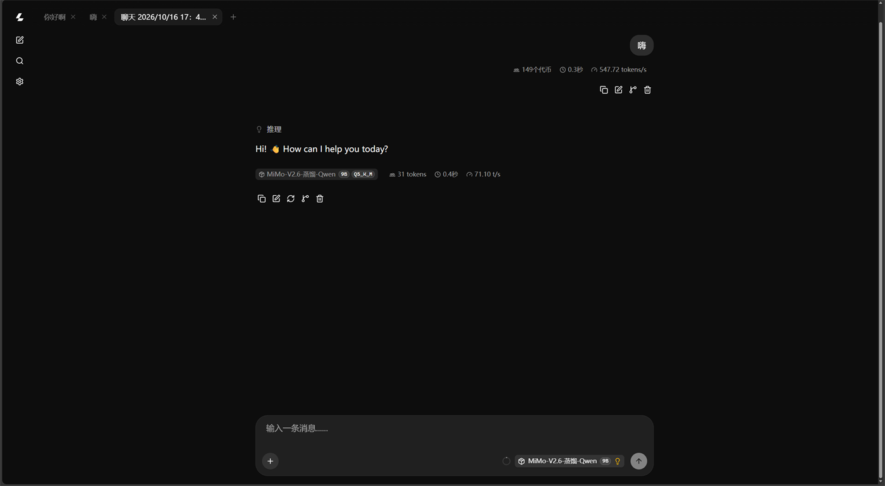

# portable-ai-usb · 零联网便携 AI

> 把一个大模型装进 U 盘。插到任何一台 Windows 电脑上双击就能用，macOS / Linux 上也能跑，**用的时候全程不需要网络**。



一个 9B 参数的大模型，连同推理引擎、运行库、聊天界面，全部躺在一支普通 U 盘里。
换一台电脑、换一个盘符、换一套显卡，插上去双击 `启动AI.bat` 就行。
对方电脑上什么都没装过也能跑：不用装 Python，不用装 CUDA，不用装 Visual C++ 运行库，不用联网。

```
U盘 ──插入──> 陌生电脑 ──双击──> 浏览器打开 http://127.0.0.1:8080 ──> 开始对话
                                    ↑
                           全过程零联网、零安装、零残留
```

> **这个项目没有推广，只有一个人在做。** 如果它帮到你了，回个 star；更欢迎在
> [Issues](https://github.com/KAYOYAK/portable-ai-usb/issues) 里留一句你的硬件和实测速度 ——
> 我手上只有一台电脑、一支 U 盘，[docs/硬件与性能.md](docs/硬件与性能.md) 里那张速度表
> 需要更多人的真实数字才站得住。跑不起来也欢迎来骂，那是更有用的信息。

---

## 为什么不直接用 Ollama / LM Studio 便携版？

因为**它们的"便携"大多从第二次启动才开始**：

|  | 常见便携方案 | **本项目** |
|---|---|---|
| 首次启动 | 需要联网（至少要把模型下下来） | **完全离线**，插上就能用 |
| 模型 | 首次使用时下载 | **6.4 GB 已经躺在盘里** |
| 运行时依赖 | 自带 Node.js / Electron（几十~几百 MB） | **无** —— 只用系统自带的 PowerShell |
| 加速后端 | 通常一套，或按当前机器配一套 | **CUDA / Vulkan / CPU 三套随身带，自动降级** |
| VC++ 运行库 | 多数未处理 | **app-local 部署，不碰宿主系统** |
| 宿主残留 | 视方案而定 | 日志与模型缓存都写回 U 盘 |
| 体积 | 小（因为模型不在里面） | ~7.3 GB（因为模型在里面） |

最直接的一个例子是 [Uncensored AI Studio](https://github.com/techjarves/Uncensored-Local-Studio)，
它的 README 写得很坦白：

> On first launch, the script automatically **downloads** a portable Node.js runtime and precompiled binaries
> for the corresponding GPU backend.

于是"便携"是从**第二次**启动才成立的。第一次你必须能上网。

在**无网络、空气隔离、内网、需要确定性交付**的场景里，这条路直接断掉 ——
不是"慢一点"，是**跑不起来**。

这个项目反过来做：**引擎、运行时、模型全部预置，U 盘里就是全部**。

### 什么时候你该用别的

说句实在话：

- **你有网、而且只在一台固定电脑上用** → 装 Ollama 或 LM Studio 更省事，别折腾 U 盘。
- **你要的是图形界面、模型商店、一键换模型** → 它们的体验比这个项目好得多。
- **你想在一台没有显卡的机器上跑"聪明"的模型** → 9B 就是 9B，换更大的模型才是正解
  （本项目的 `models\` 支持随便换，见 [使用说明.txt](使用说明.txt)）。

本项目的取舍只有一个：**拿体积换"拔了网线照样能用"**。

**核心主张：用的时候零联网。** 准备阶段（把东西塞进 U 盘）当然可以联网；
但准备完之后，这支 U 盘再也不需要网络。

---

## 快速开始

### 1. 准备（需要联网，做一次）

在一台能上网的 Windows 电脑上：

```powershell
git clone https://github.com/<你的用户名>/portable-ai-usb.git
cd portable-ai-usb
powershell -ExecutionPolicy Bypass -File tools\准备U盘.ps1
```

脚本会问你 U 盘是哪个盘符，然后自动完成：
- 检查 U 盘是不是 exFAT（FAT32 装不下 6.4 GB 的模型，会提示你格式化）
- 从 llama.cpp 官方 release 下载 **CPU / Vulkan / CUDA** 三套引擎
- 从 HuggingFace 镜像下载 **MiMo-V2.6-Distill-Qwen-9B** 的 GGUF 模型（约 6.4 GB）
- 补齐 Visual C++ 运行库 DLL（app-local，不动宿主系统）
- 全部复制进 U 盘，并做完整性校验

### 2. 使用（不需要联网）

**Windows** —— U 盘插到任意 Windows 电脑上，双击：

```
启动AI.bat
```

**macOS / Linux** —— 同一支盘，同一个 `models/`，换个调用方式：

```sh
bash 启动AI.sh              # 自动挑模型、自动挑引擎
bash 启动AI.sh --list       # 看看盘里有哪些模型
bash 启动AI.sh --help       # 全部选项
```

首次约 50 秒（取决于 U 盘读取速度，启动器会现场测并给出预估），之后热启动约 10 秒。浏览器自动打开，开始对话。

> U 盘一般是 exFAT，exFAT 没有 Unix 权限位，`chmod +x` 存不住 —— 所以是 `bash 启动AI.sh`
> 这样显式调用，而不是 `./启动AI.sh`。
>
> **模型文件跨平台通用，引擎不通用。** `models/*.gguf` 两边都能直接用；
> 但 `llama.cpp/` 下要给 macOS / Linux 各放一份引擎（缺的时候脚本会告诉你该下哪个）。
> 只做 `准备U盘.ps1` 的话盘里只有 Windows 引擎 —— 这是有意的，那三套已经 850 MB 了。

### 3. 需要手动挡的时候

Windows 双击 `高级选项.bat`：

```
[1]  NVIDIA  -  32K 上下文   (最常用)
[2]  NVIDIA  -  64K 上下文   (长文档 / 长对话)
[3]  NVIDIA  -   8K 上下文   (小显存机)

[4]  AMD / Intel 显卡  (Vulkan)
[5]  纯 CPU 模式  (任何电脑都能跑, 速度慢)

[6]  仅检测硬件, 不启动
[7]  停止本 U 盘的 AI
[8]  打开 AI 网页界面
[9]  环境自检  (U盘文件是否齐全)
[10] 选择使用哪个模型  (models\ 下有多个时)
[11] 测一下这支 U 盘的速度  (看看要等多久)
[12] 启动  -  不用 mmap  (慢盘卡顿时用, 占内存)
[13] 启动  -  关掉默认说中文  (让模型自己挑语言)
[14] 启动  -  局域网模式  (手机、平板连同一个 wifi 也能用)
[15] 启动  -  让 AI 读文件  (回答「这个文件里写了什么」)

[16] 设置  (看配置 / 改中文提示 / 改端口 / 调参数)
[17] 生成硬件反馈报告  (跑不动时发给作者)
[18] 模型管理  (看详情 / 换模型 / 删掉不用的)

[19] 启动  -  让 AI 改文件  (自动留备份, 关掉时列出它动了哪些)
[20] 检查更新  (有新版才吭声)
```

macOS / Linux 上是同一套能力的命令行开关：`--model` / `--probe` / `--stop` /
`--bench` / `--ctx` / `--ngl` / `--load-mode` / `--lan` / `--no-system-prompt` /
`--system-prompt` / `--read-files` / `--allow-write` / `--tool-dir` /
`--temp` / `--top-p` / `--top-k` / `--min-p` / `--repeat-penalty` / `--n-predict` /
`--check-update`，`--help` 里列全了。

### 4. 默认说中文

豆包、ChatGPT 这类服务里你用中文提问，它就用中文答；但本地小模型不一定 ——
这个 9B 模型第一次实测时，对着「嗨」回了一句 `Hi! 👋 How can I help you today?`。

启动器默认替你把这句话补在对话最前面：

```
中文回答。不要出现英文单词。需要读文件就直接调工具。
```

三条边界：

- **客户端自己带了 system 消息时，以客户端的为准**，这句不生效 —— 你在 Cherry Studio、
  沉浸式翻译这类工具里配了自己的人设，不会被它盖掉。
- **你明说要别的语言时它不抢**。实测 `Answer in English: ...` → 回英文。
- 只在模型名与 `templates\*.jinja` 对得上时才注入；换了别的模型而没有对应模板，
  启动器会在启动信息里说明「本次不注入」，不会拿不配套的模板硬套。

> 最后那句「需要读文件就直接调工具」不是凑数的。一开始用的是
> 「中文回答。回答必须全部是简体中文，不要出现英文单词。」—— 你问
> 「项目.txt 里写的交付日期是哪天？**直接告诉我日期**」时，后半截在叫它别查，
> 它就真不查，还编一句「我还没看到这个文件」。加上那句之后同一条问题 5/5 都调工具了，
> 中文那关一分没掉。催得越急越容易踩到，所以得写进去。

不想要的话用 `高级选项.bat` 的 `[13]`，或者 `bash 启动AI.sh --no-system-prompt`。
想换成自己那句用 `[16]`。

### 5. 让 AI 读文件

菜单 `[15]`。启动后，把想让 AI 看的文件丢进 U 盘上的 `workspace\` 文件夹，
然后直接问「项目笔记.txt 里写了什么」—— 它会**自己去读**，不用你把内容贴进对话框。

实测（全新对话，不提示它去读）：

| 你的问题 | 它自己调的工具 | 回答 |
| --- | --- | --- |
| `项目.txt 里的交付日期是哪天？` | `read_file` | `六月九号，即 6月9日` ✅ |
| `workspace 里有几个文件？分别叫什么？` | `file_glob_search` → `get_info` → `file_glob_search` | `两个：项目.txt、notes.md` ✅ |
| `项目.txt 里的负责人是谁？预算多少？` | `read_file` | `林工，八十三万` ✅ |

边界：

- **默认只读**：能读文件、找文件、搜内容、看环境；**不能改、不能删、不能执行命令**。
  想放开那三样要命令行加 `-AllowWrite` —— 那等于把这台电脑交给模型，故意的，
  不放进菜单里按一个数字就能做。
- **只能看见 `workspace\` 里的东西**。目录之外的路径会被引擎拒绝。
- **文件夹名必须保持英文 `workspace`**。实测引擎在中文目录下列举目录会直接 500
  （`No mapping for the Unicode character exists in the target multi-byte code page.`）——
  这是 llama.cpp 用窄字符 Win32 API 列举目录的老毛病。**里面的文件名用中文没问题**，
  只有目录名不行；启动器会在你手动指到中文路径时当场警告。
- **和 `[14]` 局域网模式互斥**：开着读文件时，引擎为了安全会把 CORS 强制限制到本机，
  手机连上来能聊天但读不了文件。启动时会打印这条提示。

#### 5.1 让它动手改文件

菜单 `[19]`。比只读多开了 `write_file` / `edit_file`，于是「往这个文件末尾加一行」
这类事它自己能做完。配套两件事是刻意做的：

- **启动时先把 `workspace\` 里现有的文件备份一份**到 `workspace\.backup\<时间戳>\`
- **关掉时列出它动过哪些文件**（新写 / 改动 / 删除），并告诉你备份在哪。想退回去，
  把备份目录里的文件复制回 `workspace\` 覆盖就行

`exec_shell_command`（执行命令）**故意没给**：Windows 上它是 cmd，中文输出会变成问号
（实测 `echo 你好` 回来是 `'- ???? '`），而且「能改文件」和「能在这台电脑上执行任意命令」
是两件量级不同的事，不该按一个数字就一起交出去。所以这一项只能从命令行开，
而且和局域网模式同时开时启动器会单独提醒一句。
### 6. 改设置、看设置

菜单 `[16]`。每次启动会往 U 盘根目录写一份 `当前设置.txt`，用记事本打开就能看见
**这次到底按什么配置跑的** —— 模型、上下文、KV 精度、端口、系统提示的原文和来源。
以前这些只在那块黑底窗口里出现过，窗口一关就没了。

想改的话同一个菜单里能改两样最常动的：

- **改默认中文提示** → 写进 `系统提示.txt`。留空/删掉就回到内置那句。
- **改端口** → 写进 `端口设置.txt`。默认 8080；8080 被占用时启动器会自己往上找，
  那种情况不用手改（实际落到的号写在 `logs\端口.txt`，菜单 `[8]` 读它）。

命令行 `-SystemPrompt` / `-Port` 优先于这两个文件 —— 临时指定不该被动过的文件悄悄盖掉。

macOS / Linux 侧（`启动AI.sh`）读的是**同样两个文件**（`系统提示.txt`、`端口设置.txt`），
来源顺序也一样：`--system-prompt` > `系统提示.txt` > 内置那句。
区别只在于它没有菜单，这两个文件得自己建：

```sh
echo '只说日语。' > 系统提示.txt     # 改默认提示
echo '9000'       > 端口设置.txt     # 改默认端口
rm 系统提示.txt                       # 删掉就回到内置那句
```

`启动AI.sh` 启动时也会写一份 `当前设置.txt`，格式和 Windows 侧一样。

### 7. 跑不动时：生成反馈报告

菜单 `[17]`。跑不动最烦的是「不知道该告诉对方什么」，这个一键把需要的都收齐：
CPU 型号核数、内存、显卡、**驱动版本**（内部号 `32.0.16.1742` 会换算成你认得的 `617.42`）、
三套引擎各自实际看得见的设备、以及启动器探测的完整输出。

写到 `反馈报告.txt`，同时在屏幕上打一遍方便复制。开头两行留给你填
（**结果**、**生成速度**）—— 这两个只有你能测，其余都是自动的。

它是个独立脚本，**不依赖引擎能起来** —— 引擎起不来的时候正是最需要它的时候：

```
powershell -ExecutionPolicy Bypass -File tools\反馈报告.ps1
```

### 8. 模型管理

菜单 `[18]`。`models\` 里放多个模型时用得着：每个模型的体积和**量化档位**
（`Q5_K_M` / `IQ4_XS` / `F16` …，从文件名读出来 —— 它直接决定吃多少显存、掉多少智商）、
哪个是当前用的，以及删掉不用的腾空间。删除要手打 `YES` 确认，删掉的正好是当前模型时
会顺手清掉指针。
### 9. 调参数

菜单 `[16]` → `[6]`，或者直接改 U 盘根目录的 `参数设置.txt`：

```
temp           = 0.6     越低越稳、越高越发散          0 ~ 2
top_p          = 0.95    采样范围                      0.05 ~ 1
top_k          = 20      候选词数量                    1 ~ 200
min_p          = 0       低于这个比例的词直接丢掉       0 ~ 1
repeat_penalty = 1.1     重复惩罚                      0.5 ~ 2
n_predict      = -1      单条最长输出，-1 = 不限制      -1 或 1 ~ 32768
threads        = 0       用几个 CPU 线程，0 = 自动     0 或 1 ~ 256
```

改完重启生效。命令行 `--temp 0.2` 之类会盖过文件。原来的 0.6 / 0.95 / 20 是写死在
启动器里的，现在能改了 —— 想让它更稳（写代码、翻译）就把 `temp` 调到 0.2，
想让它更活（写文案）就调到 0.9。

`threads` 默认按核数自动（上限 8）。调它多半是在慢盘或老机器上把线程压到物理核数以内求稳 ——
超过物理核数一般只会更慢，启动器会提醒一句但不拦你。

不想要这个文件了，用菜单 `[16]` → `[7]` 删掉，一切回到内置默认。

### 10. 有没有新版

菜单 `[20]`，或者 `bash 启动AI.sh --check-update`。没网、已是最新都不吭声；
正常启动时也会顺手静默问一次，只有真出了新版才多打一行。启动路径上不该多出噪音。

### 11. 它自己会盯着

启动之后启动器不会把引擎一扔就不管 —— 每 3 秒看一眼。

- **引擎崩了会直说。** 以前不管是你按 Ctrl+C，还是显存被抢导致引擎退出，屏幕上都只有同一句
  「引擎已停止」，而浏览器那头页面还开着、每次发消息都失败 —— 分不清是崩了还是你关了窗口。
  现在异常退出会打一整屏红字，带常见原因清单和日志最后 12 行。从菜单 `[7]` 主动停的不算崩溃
  （`--stop` 会先留一个三分钟内有效的标记）。
- **上下文快满了会提醒。** 用到 80% 提一句；真的塞不下时（引擎报
  `request (6526 tokens) exceeds the available context size (4096 tokens)`）会把
  「这次要多少 / 上限多少」直接写出来，而不是让你对着一个转圈猜。
- **聊过的内容留档。** 引擎的对话历史只活在页面里，一关就没了（实测前端把所有状态放在浏览器内存中，
  localStorage 只存界面设置，也没有导出功能）。所以启动器让引擎把每次请求的完整 prompt 记在
  `logs\prompts\`，再转成能读的 `logs\对话\<时间戳>.txt`。直接关窗口、断电也能补上 ——
  因为转存是在**下一次启动时**做的，不依赖优雅退出。
  每份开头记着那次的配置（模型 / 后端 / 上下文 / 线程 / KV），事后翻旧记录知道当时用的是哪个模型。
  已知缺口：引擎是「发送前」记的，最后一句 AI 回答不在里面。
- **速度是量出来的，而且分两段。** 就绪后发一个真请求，把返回里的 `timings.predicted_per_second`
  和 `timings.prompt_ms` 一起打出来，存进 `logs\速度.txt`：生成速度是「它写多快」，首字延迟是
  「你按下回车之后要等多久才见到第一个字」—— 后者随对话变长而变大，长对话里它才是体感的主要来源。
  `tools\反馈报告.ps1` 会自动读这个文件 —— 提 issue 时不用拿感觉形容「有点慢」。
  每次的速度还会往 `logs\速度历史.txt` 追加一行（留最近 50 条），「今天是不是比昨天慢」有据可查。
  反馈报告里带的是**最近 10 条**历史 + 最近一次引擎日志的末尾 20 行，不必再让人手动贴。
  macOS / Linux 的 `启动AI.sh` 同样从引擎返回里取 `prompt_ms`，横幅里也是两个数。
- **工具链一开机就试一遍。** 开了读/写文件之后，启动器会真的调用一次 `/tools` 再让它列一次目录。
  中文目录名会让引擎的列举类工具直接 500（见「已知限制」），这件事本来要等你问到一半才暴露；
  现在启动横幅里就写着「工具链 : 4 项可用，试着列了一下看见 2 项」，坏了当场报原因。
- **备份攒了多少会告诉你。** 开写权限时每次启动都整目录备份一份到 `workspace\.backup\`，
  这个目录只增不减。横幅里显示一共几次、多少个文件、占多少 MB，超过 300 MB 会提醒；
  菜单 `[21]` 可以只留最近一次、按编号删某一次、或者全删。
- **参数写错了会当场说。** `参数设置.txt` 里拼错键名、值超出范围、那一行不是「键 = 值」，
  启动时逐行打黄字并说清第几行错在哪。以前这四类提示都拼进了变量却从没打印过 ——
  改的那行没生效，引擎照常启动，用户只会觉得「调了参数怎么没变化」。
- **模型比显存大的时候不再硬塞。** 以前上下文只按「显存多大」定，不看模型本身多大：
  同一张 8 GB 卡，14 GB 的模型照样给 99 层，开跑就 OOM，报的却是「显存被别的程序抢了」。
  现在启动前算 `模型 + KV + 计算缓冲`，装不下就不传 `-ngl`、改传 `--fit on`，由引擎按真实
  层数自己定 —— 横幅里写「显存卸载 : 自动」并说明差多少。
- **日志不会无限长。** 每次启动写一对 `logs\server-<时间戳>.log` / `.log.out`，只留最近 20 对。
  想找某一次崩溃，不用在六十个时间戳里挑。`端口.txt` / `速度.txt` / `上次对话.txt` 不受影响。
- **每次对话都留一份。** 菜单 `[22]` 列出 `logs\对话\` 里的每一次（留最近 30 次），
  显示时间、大小、行数，挑一份把末尾几行打出来，按 `y` 用记事本读全文。
  以前只留一份「上次对话」，聊完 A 事再聊 B 事，A 就没了。
- **版本号一眼可见。** 菜单标题、`自检.ps1`、`反馈报告.txt` 三处都现读 `launcher.ps1` 的
  `$AppVersion`，不存副本 —— 报问题时报的就是那一行。
- **换过模型也算得清。** `models\校验.txt` 记着每个模型的 SHA-256、字节数和写入时间。
  `准备U盘.ps1` 下载时写，`换模型.ps1` 下完也写；`自检.ps1` 会读它，标出清单是哪天写的，
  并把清单里有、盘上没有的模型列出来（换了模型却没更新清单，一眼能看见）。
  以前这份哈希验完就丢，下一次自检没法复查模型是不是被改过。

`--no-speed-test` / `-NoSpeedTest` 可以跳过测速，就绪会快几秒（首字延迟也就没有数了）。

macOS / Linux 那份 `启动AI.sh` 也已经补上：不再用 `exec` 把进程交出去，而是后台启动、`trap`
接管 Ctrl+C、并盯着退出码。崩了会打「退出码 + 最后 12 行日志 + 常见原因」，你自己停的则是
「引擎已停止（你让它停的）」—— 和 Windows 那份措辞一致。加载期间每 2 秒从日志里报一次阶段
（正在读模型文件 → 正在把权重装进显存 → 开始监听），不会让你对着黑屏等 50 秒。它仍然没有
上下文告警和工具链自检 —— 那两样要解析日志和调 HTTP，留给了 Windows 那份。

---

## 它是怎么挑后端的

这是整个项目里最值得说的一部分。启动器不会问你"你有显卡吗"，它自己探：

```
检测到 NVIDIA 显卡？
  ├─ 是 → 试 CUDA   ── llama-server --list-devices 能列出 CUDA0？
  │         ├─ 能 ────> 用 CUDA 13.4        (最快)
  │         └─ 不能 ──> 试 Vulkan
  └─ 否 → 试 Vulkan ── 能列出 Vulkan0？
            ├─ 能 ────> 用 Vulkan             (AMD / Intel / 老 NVIDIA 通用)
            └─ 不能 ──> 纯 CPU               (兜底，任何 x86-64 机器都能跑)
```

挑到后端之后再按显存自动配上下文长度和 KV 缓存精度：

| 显存 | 上下文 | KV 缓存 |
|---|---|---|
| ≥ 15 GB | 65536 | q8_0 |
| ≥ 11 GB | 32768 | q8_0 |
| ≥ 8 GB | 16384 | q8_0 |
| ≥ 6 GB | 8192 | q8_0 |
| > 0 但 < 6 GB | 4096（只卸载 20 层） | q4_0 |
| 纯 CPU | 8192 | f16 |

**为什么值得这么麻烦**：一支 U 盘要面对的是"任何一台电脑"，可能是游戏本、可能是办公机、可能是十年前的老机器。
三套引擎加起来 850 MB，换来的是**永远有能跑的那一套**。

### 关于 CPU 指令集

llama.cpp 官方的 Windows 包已经做了**运行时 CPU 分发**
（编译选项 `-DGGML_CPU_ALL_VARIANTS=ON -DGGML_NATIVE=OFF -DGGML_BACKEND_DL=ON`），
解压出来能看到 14 个 `ggml-cpu-*.dll`，从 `sandybridge` 一路到 `zen4`。

同一个 `llama-server.exe` 在任何 x86-64 机器上都会自动加载匹配的那个 DLL。
**不需要自己编译**。（这一点跟某些项目"启动即 Illegal instruction"的坑正好相反 —— 那些项目发的是 `GGML_NATIVE=ON` 的本机优化版。）

---

## 实测数据

测试机：AMD Ryzen 16 核 / 31.2 GB 内存 / NVIDIA RTX 5070 Ti Laptop 12 GB / Windows 11
模型：MiMo-V2.6-Distill-Qwen-9B **Q5_K_M**（6.40 GB）
引擎：llama.cpp b11270

### 纯生成速度（`llama-bench -p 0 -n 48`）

| 后端 | 速度 |
|---|---|
| CUDA 13.4 | **62.07 tok/s** |
| Vulkan | **48.53 tok/s** |
| CPU | 3.43 tok/s |

### 端到端（从 U 盘启动到能对话）

| 环节 | 耗时 |
|---|---|
| CUDA 引擎冷启动（首次，从 U 盘读模型） | ~52 秒 |
| CUDA 引擎热启动 | ~10 秒 |
| Vulkan 引擎 | ~9 秒 |
| CPU 引擎 | ~5 秒 |
| 实际对话生成速度 | 17 ~ 33 tok/s |

换过盘符（用 `subst` 把 U 盘映射成别的字母）后启动成功，**启动器不依赖盘符**。

### 三套引擎的实际体积

| 后端 | 下载 | 装好后 | 文件数 |
|---|---|---|---|
| CUDA 13.4（含 cudart） | ~549 MB | 711.9 MB | 65 |
| Vulkan | 31.6 MB | 91.9 MB | 62 |
| CPU | 18.3 MB | 48.7 MB | 61 |

---

## 已经在哪些情况下验证过

| 验证项 | 结果 |
|---|---|
| 从 U 盘直接跑 CUDA 推理 | ✅ |
| 把 CUDA 屏蔽掉（`CUDA_VISIBLE_DEVICES=-1`）后自动降级到 CPU | ✅ |
| 换盘符（`subst` 映射）后依然能启动 | ✅ |
| Visual C++ 运行库从 U 盘加载，不依赖宿主安装 | ✅ 用 `Get-Process -Module` 核实过加载路径 |
| exFAT 卷上没有"来自 Internet"标记，不触发 SmartScreen | ✅ |
| 宿主系统盘完全不写（日志、缓存全在 U 盘） | ✅ |
| **在一台全新的、从没装过任何开发工具的 Win11 笔记本上** | ✅ **2026-10-16 真机实测通过** |

最后一条是这张表里最要紧的一条，也是「零联网便携」这个定位本身要证的事：

一台出厂状态的 Windows 11 笔记本，**没装过 Visual C++ 运行库，没有 Python / Node / CUDA，
没连过网**，插上 U 盘双击 `启动AI.bat` 直接就起来了。

它之所以能成立，靠的是前面那条 —— VC++ 运行库以 app-local 方式躺在 `llama.cpp\<后端>\`
目录里，Windows 的 DLL 搜索顺序会优先在同目录找，于是不依赖宿主机装过任何东西。

---

## 目录结构

```
U盘根目录/
├── 启动AI.bat              ← Windows：双击这个
├── 启动AI.sh               ← macOS / Linux：bash 启动AI.sh
├── 高级选项.bat            ← 手动选后端
├── launcher.ps1            ← 启动器（自动探测 + 三级降级）
├── 使用说明.txt
├── docs/                   ← 参考文档、FAQ
├── llama.cpp/
│   ├── cuda13/             ← llama-server.exe + 依赖 DLL（含 vcruntime，app-local）
│   ├── vulkan/
│   ├── cpu/
│   └── macos-arm64/ …      ← 非 Windows 引擎放这里（按需自己下）
├── models/
│   ├── MiMo-V2.6-Distill-Qwen-9B-Q5_K_M.gguf
│   └── 当前模型.txt        ← 有多个模型时指定用哪个
├── tools/                  ← 准备U盘 / 换模型 / 自检 / 菜单
└── logs/                   ← 运行日志（自动创建）
    ├── server-<时间戳>.log  ← 引擎日志，留最近 20 对
    ├── 对话/                ← 每次对话一份，留最近 30 份
    ├── 上次对话.txt          ← 最新那份的副本（老路径不变）
    ├── 速度.txt / 速度历史.txt
    └── 端口.txt
```

**整个目录是自包含的。** 把它拷到另一个 U 盘、另一个分区、另一个盘符，一样能跑。
`launcher.ps1` 里所有路径都由 `$PSScriptRoot` 拼出来，`启动AI.sh` 用脚本自身所在目录，
两边都没有任何一处写死盘符。

**改脚本之前先看这条。** 三种文件的行尾和 BOM 要求各不相同，错了都是"读进去就坏"，不是显示问题：

| 文件 | 编码 | 行尾 | 错了会怎样 |
|---|---|---|---|
| `.ps1` | **UTF-8 带 BOM** | LF | 无 BOM 时 PowerShell 5.1 按 ANSI 码页解码，中文全变乱码 |
| `.bat` | **不带 BOM** | **CRLF** | 带 BOM 时 cmd 会把 BOM 当成一条命令去执行；LF 时按 CRLF 切分会错位 |
| `.sh` | 不带 BOM | **LF** | 行尾带 CR 时 bash 报 `$'\r': command not found` |

`.gitattributes` 里已经按这个表配好了（`* text=auto eol=lf`、`*.bat eol=crlf`、`*.sh eol=lf`），
但好几种编辑器会**默认把 BOM 去掉**，改完 `.ps1` 记得确认一下。

---

## 硬件要求

|  | 最低 | 推荐 |
|---|---|---|
| U 盘 | USB 3.0，16 GB，exFAT | USB 3.0+，64 GB |
| 系统 | Windows 10 / 11 x64；macOS 11+；Linux x64 | Windows 11 x64 |
| 内存 | 8 GB | 16 GB+ |
| 显卡 | 无所谓（会降到 CPU） | NVIDIA（走 CUDA）或任意支持 Vulkan 的卡 |

**U 盘必须格式化成 exFAT 或 NTFS。** FAT32 单文件上限 4 GB，装不下 6.4 GB 的模型。

### 速度的现实

本机那支 USB 3.x 闪存盘：顺序读 **127~146 MB/s**、随机 4K **约 2,000 IOPS**、
冷启动加载 6.4 GB 模型 **实测 53.7 秒**（同样的模型放内置 NVMe 只要 5 秒）。

启动器每次启动都会现场测一遍并给出预估等待时间，菜单 `[11]` 也能单独测盘。
分档、怎么挑盘、插哪个口 → [docs/硬件与性能.md](docs/硬件与性能.md)。

**别把 KV 缓存开得超过物理内存的 20~30%**，否则会开始换页，速度断崖式下跌。

---

## 不会干扰宿主机

一支 U 盘要插到别人电脑上，最容易出事的就是"手伸太长"。这里做了三件事：

- **停止 AI 时只停自己的。** `高级选项.bat` 的 [7] 不用 `taskkill /IM llama-server.exe`，
  而是按可执行文件路径过滤，只终止位于本 U 盘目录内的进程。宿主上另跑的 llama-server 会被跳过并打印出来。

- **端口被占时先认人。** 8080 被占时，启动器会向那个服务请求 `/props`，
  看它的 `model_path` 是否指向本 U 盘的模型。是 → 直接打开页面；不是 → 自动改用 8081~8100 的空闲端口，
  而不是硬挤上去。

- **运行产物全部落在 U 盘。** 日志写进 `logs\`，模型缓存也由环境变量指回盘内。

## 已知限制

这一节刻意写得比项目介绍长。一个"便携 AI"值不值得用，取决于它的边界在哪，不取决于它能做什么。

### 平台

- **Windows 是主战场，macOS / Linux 能用但要自己补引擎。** `启动AI.sh` 在两边都能跑
  （自动探测、挑模型、测速、启停都有），但 `准备U盘.ps1` 只往盘里装 Windows 那三套引擎 ——
  Apple Silicon 上还多一层：官方预编译包是 macOS 11+ 的，老系统得自己编。
  引擎缺的时候脚本会直接告诉你下哪个文件、放哪个目录，不会去网上乱找。
- **Windows 11 S 模式** 会拒绝运行非商店应用，需要先退出 S 模式。
- **Windows on ARM**（骁龙本）没有对应引擎包，跑不了。macOS 的 Apple Silicon 是原生 arm64，没问题。

### 权限与环境

- **企业受管电脑** 如果策略禁止从可移动介质执行程序（AppLocker / WDAC），这条路走不通。
  这是策略层面的限制，不是技术问题 —— 加白名单也没用。判定方法与对策见 [docs/杀毒软件误报.md](docs/杀毒软件误报.md)。
- **杀毒软件** 偶尔会拦 `llama-server.exe`（未签名 exe + 监听端口，启发式容易误判）。加白名单即可。
- **不需要管理员权限**，但如果目标机器上已经有什么程序占了 8080~8100 整段端口，会启动失败。

### 性能

- **没有独显的机器** 会退到纯 CPU，约 3.4 tok/s —— 能用，但只适合短对话。
- **冷启动 50 秒起步**，取决于 U 盘速度。本机那支 USB 3.x 闪存盘实测 53.7 秒；
  插到 USB 2.0 口上会掉到 4~5 分钟。**这是整个方案里最硬的一道墙。**
  启动器会现场测盘并给出预估等待时间，菜单 `[11]` 可单独测 —— 详见
  [docs/硬件与性能.md](docs/硬件与性能.md)。
- **内存小于 8 GB** 会很吃力。启动器会自动压低上下文并改用 q4_0 KV 缓存，但仍然会频繁换页。

### 能力

- **模型是 9B。** 它能做工具调用、能写代码、中文也可以，但它不是 GPT-4 级别的模型。
  需要更强的话往 `models\` 里换更大的 GGUF 就行。
  盘里带了 [tools\换模型.ps1](tools/换模型.ps1)，列了几个已知能跑的小模型直接下 ——
  也可以用 `高级选项.bat` 的 [10] 在已有模型之间切换。详见 [使用说明.txt](使用说明.txt)。
- **上下文默认 32K**，不是无限的。显存够的机器可以用 `高级选项.bat` 的 [2] 开到 64K。
- **界面就是 llama.cpp 自带的 WebUI**，够用但很朴素，没有对话历史管理。
- **改文件不做事后确认。** `[19]` 会自动备份、关掉时列清单，但它不逐条问「这一行能改吗」——
  它按你的话直接做。所以 `workspace\` 里放你让它动的文件，别把整个项目目录丢进去。
- **工具调用不是百分百。** 9B 的模型偶尔会不调工具直接编答案；把问题问得具体一点
  （说清文件名）会稳很多。实测同一类问题 15/15 命中，但这不是保证。
- **看图能力默认是关的。** MiMo 有视觉能力，但需要额外把 `mmproj-*.gguf` 放进 `models\`。
  启动器会自己检测：有就打开（并明确打印文件名），没有就**显式传给引擎 `--no-mmproj`**。
  显式关掉这一步不是可选项 —— 引擎在"没给投影文件"时存在自己去下载的路径，那就要联网，
  而这个盘的卖点之一就是首次启动完全离线。

更多见 [docs/常见问题.md](docs/常见问题.md)。

**想知道这东西怎么踩出来的** → [docs/踩坑记录.md](docs/踩坑记录.md)。
`cmd.exe` 解析中文 `.bat` 错位、VC++ 运行库 app-local、断点续传下坏文件、
PowerShell 的大小写陷阱…… 每条都带报错原文，方便搜过来。

---

## Roadmap

按"对一个陌生用户的实际价值"排序，不是按开发难度。

### 想做

- [ ] **一段 GIF** —— 截图已经有了，但"插上 → 双击 → 开始对话"这 15 秒的过程，
      动态演示比静态图更有说服力。
- [ ] **让 [docs/硬件与性能.md](docs/硬件与性能.md) 里的表格带上更多真实机器的数据** ——
      这一条靠 [硬件兼容性反馈](.github/ISSUE_TEMPLATE/hardware_report.yml) 里收到的记录，
      我一个人凑不出来（见下面的"参与"）。

### 明确不做

- **不做图形安装器。** 双击一个 `.bat` 已经是最短路径；再加一层 Electron 就等于把"零依赖"这个卖点自己拆了。
- **不把模型打包进仓库。** 6.4 GB 放不进 Git，也放不进大多数人的耐心。
- **不盲目追最新引擎版本。** 现在锁定 b11270 并校验 SHA-256；升级要重新验三套后端的
  `--list-devices` 与显存分档，不是改个版本号的事。
- **不在 U 盘里塞四个平台的引擎。** 加一套就多几百 MB 到 1 GB。现在盘里只放 Windows 那三套；
  别的平台缺引擎时脚本告诉你下哪个，一条 `curl` 的事。

### 已完成

- [x] 多模型支持（v1.1.0）
- [x] 在一台全新的 Windows 11 笔记本上实测通过（v1.0.1）
- [x] README 顶部放一张实机运行的界面截图（v1.1.0）
- [x] [开发过程踩坑记录](docs/踩坑记录.md)（v1.1.0）
- [x] **U 盘速度自测 + 加载时间预估**（v1.1.1）—— 启动时实测顺序读，报"预计约 N 秒"；菜单 `[11]` 可单独测
- [x] **慢盘兜底开关**（v1.1.1）—— `-LoadMode none` / 菜单 `[12]`：不用 mmap，整块读进内存
- [x] **macOS / Linux 启动器**（v1.2.0）—— `启动AI.sh`，同一支盘同一份模型，两个平台的引擎按目录约定各放各的
- [x] **多模态开关**（v1.2.0）—— 检测到 `models/mmproj-*.gguf` 就自动打开视觉能力，没有就显式关掉
- [x] **换模型脚本**（v1.2.0）—— `tools/换模型.ps1`，从 HuggingFace 镜像下几个已知能跑的小模型
- [x] **公共脚本抽取**（v1.2.0）—— `tools/_公共.ps1`：下载/校验/断点续传只有一份实现
- [x] **启动进度条**（v1.3.0）—— 等 50 秒时显示 `[####..] 34s / 约51s  正在读模型文件…`
- [x] **加载失败自动降档**（v1.3.0）—— 显存不够时自己砍上下文、降 KV 精度，再不行退纯 CPU
- [x] **局域网模式**（v1.3.0）—— `-Lan` / `--lan` / 菜单 `[14]`：手机、平板连同一个 wifi 就能用
- [x] **默认说中文**（v1.3.0）—— 借模型自己的模板补一句系统提示；客户端带了 system 或用户明说要别的语言时都不影响
- [x] **日志真的能看了**（v1.3.0）—— 以前 `server-*.log` 永远是空的（llama.cpp 走 stderr）
- [x] **模板匹配取最长**（v1.3.1）—— 同时有通用模板和专用模板时不再按字母序碰运气，和全仓模型名匹配统一
- [x] **让 AI 读文件**（v1.4.0）—— `-ReadFiles` / `--read-files` / 菜单 `[15]`：丢进 `workspace\` 直接问
- [x] **设置看得见、改得动**（v1.4.0）—— `当前设置.txt` / `系统提示.txt` / `端口设置.txt`，菜单 `[16]`
- [x] **硬件反馈报告**（v1.4.0）—— 菜单 `[17]`，引擎起不来时也能用（因为它不依赖引擎）
- [x] **模型管理**（v1.4.0）—— 菜单 `[18]`：体积 + 量化档位，删之前要手打 `YES`
- [x] **参数可调**（v1.5.0）—— `参数设置.txt` / 菜单 `[16]`→`[6]`：温度、top_p、top_k、min_p、重复惩罚、最长输出
- [x] **让 AI 改文件，并且看得见它改了什么**（v1.5.0）—— 菜单 `[19]`：启动先备份，关掉时列出新写/改动/删除
- [x] **上下文能聊多少轮**（v1.5.0）—— 启动信息里按当前上下文估算轮数，别让你聊到一半突然被截断
- [x] **检查更新**（v1.5.0）—— 菜单 `[20]` / `--check-update`：没网和已最新都不吭声
- [x] **引擎崩了会直说**（v1.6.0）—— 以前崩了和正常停都是同一句「引擎已停止」
- [x] **上下文满了会提醒**（v1.6.0）—— 80% 提一次；真塞不下时报「要多少 / 上限多少」
- [x] **聊过的内容能回看**（v1.6.0）—— `logs\上次对话.txt`，关窗口、断电都不丢
- [x] **速度自己量**（v1.6.0）—— 就绪后实测并存 `logs\速度.txt`，反馈报告自动填
- [x] **模型完整性可复查**（v1.7.0）—— `models\校验.txt` 记下每个模型的 sha256，自检时重算比对
- [x] **工具链开机自检**（v1.7.0）—— 启动时真的调一次 `/tools` 并列举目录，坏在哪儿当场说
- [x] **首字延迟**（v1.7.0）—— 除了「写多快」，也报「按下回车后多久见第一个字」
- [x] **备份能清**（v1.7.0）—— 横幅显示 `.backup\` 攒了多少，菜单 `[21]` 只留最近一次 / 按编号删 / 全删
- [x] **bash 看护**（v1.7.0）—— `启动AI.sh` 不再 `exec`：崩了报退出码和日志，加载期间报阶段
- [x] **线程数可调**（v1.6.0）—— `参数设置.txt` 的 `threads` / `--threads` / 菜单 `[16]`→`[6]`
- [x] **参数写错会说出来**（v1.8.0）—— 拼错键名、值超范围不再静默跳过，启动时逐行打黄字
- [x] **上次对话有入口**（v1.8.0）—— 菜单 `[22]`：时间、大小、末尾几行，按 `y` 用记事本读全文
- [x] **日志轮转**（v1.8.0）—— `logs\server-*` 只留最近 20 对，翻目录不用在几十个时间戳里挑
- [x] **bash 侧补齐告警**（v1.8.0）—— `启动AI.sh` 也有上下文轮数提示和 `/tools` 自检
- [x] **版本号一处看全**（v1.8.0）—— 菜单标题、自检、反馈报告都现读 `$AppVersion`
- [x] **对话按次存档**（v1.9.0）—— `logs\对话\<时间戳>.txt` 留最近 30 份，菜单 `[22]` 变成历史列表
- [x] **模型比显存大不再硬塞**（v1.9.0）—— 启动前算预算，装不下就交 `--fit on` 让引擎自己定层数
- [x] **速度趋势**（v1.9.0）—— `logs\速度历史.txt` 每次追加一行，留最近 50 条
- [x] **换模型时提醒引擎还开着**（v1.9.0）—— 免得改完发现界面没变化，以为是坏了
- [x] **换模型也写校验清单**（v1.10.0）—— `换模型.ps1` 下完把 sha256 / 字节数 / 时间写进 `models\校验.txt`
- [x] **存档记下当时的配置**（v1.10.0）—— 对话存档开头写着模型、后端、上下文、线程、KV
- [x] **反馈报告带速度和日志尾巴**（v1.10.0）—— 最近 10 条速度历史 + 最新引擎日志末尾 20 行，不用手动贴
- [x] **bash 也报首字延迟**（v1.10.0）—— `启动AI.sh` 从引擎返回里取 `prompt_ms`
- [x] **自检看得见校验清单**（v1.10.0）—— 清单写了多久、盘上有几个模型、清单里有而盘上没有的

---

## 参与

- **跑在什么机器上、什么结果** —— 请开一个 [硬件兼容性反馈](.github/ISSUE_TEMPLATE/hardware_report.yml)。
  这类记录比 Bug 报告更有用：它能进 [docs/硬件与性能.md](docs/硬件与性能.md)，让下一个人知道自己的机器行不行。
- **改动之前**请看 [.github/pull_request_template.md](.github/pull_request_template.md) 里的**编码约定**。
  那几条不是风格偏好，是踩过坑之后定下来的：cmd.exe 会把带中文的 `.bat` 解析错位、
  PowerShell 5.1 会把没 BOM 的 `.ps1` 按 ANSI 码页读成乱码、
  `.sh` 的行尾带上 CR 会让 bash 报 `$'\r': command not found`。
- 完整变更历史见 [CHANGELOG.md](CHANGELOG.md)。

---

## 参考与归属

这个项目是**集成**，不是发明。底下这几层全部是别人的工作：

| 组件 | 作者 | 许可 |
|---|---|---|
| [llama.cpp](https://github.com/ggml-org/llama.cpp) | Georgi Gerganov 及贡献者 | MIT |
| [MiMo-V2.6-Distill-Qwen-9B](https://huggingface.co/XiaomiMiMo/MiMo-V2.6-Distill-Qwen-9B) | 小米 MiMo 团队 | MIT |
| [Qwen3.5-9B](https://huggingface.co/Qwen/Qwen3.5-9B)（基座） | 阿里通义千问 | Apache-2.0 |

完整的归属声明与许可文本见 [THIRD-PARTY.md](THIRD-PARTY.md)。
详细的技术参考链接见 [docs/参考资料.md](docs/参考资料.md)。

关于"便携应用"这个思路本身的来源，可以追溯到 [PortableApps.com](https://portableapps.com/)（2005 年前后）。
本项目做的是把这个思路套到本地大模型上，并且**把"零联网"当作硬约束**。

## 许可

本项目自身的代码（启动器、脚本、文档）以 **MIT** 发布，见 [LICENSE](LICENSE)。
